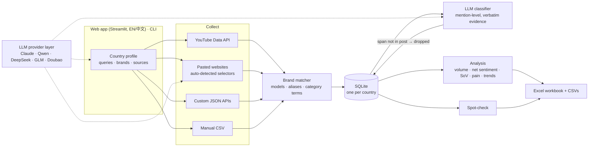

# WATERS Sentiment Engine

**Multi-country, multilingual consumer-sentiment mining for home water appliances.**
Collects public discussion from YouTube, forums and APIs; codes every opinion against a
needs framework with an LLM; and turns it into an analysis workbook — through a bilingual
(English / 中文) web app or the command line.

  

中文使用说明：[README_zh.md](README_zh.md)

---

## What it does

Point it at a country. It searches YouTube in the local languages, reads any forum
threads or JSON APIs you paste in, and asks an LLM to find every **need** each post
expresses — health and safety, speed, taste, space, trust, image, cost — together with
the sentiment attached and a **verbatim quote as evidence**. The output is a workbook
of need volumes, net sentiment by brand, share of voice, pain points and time trends,
with the evidence quotes behind every number.

**Highlights**

- **Any country, any language.** Pick a country and an LLM drafts its local search terms
  and brand watchlist (Latin brand names plus local-script aliases, so 小米 counts as
  Xiaomi). Posts are coded in their original language; quotes stay verbatim with an
  English translation beside them.
- **Paste a link, get a scraper.** Paste a forum thread and the engine works out the CSS
  selectors for its posts, then *verifies* them by extracting posts with the collector's
  own parser before anything is saved. Paste a JSON API endpoint and it maps the fields.
- **Provider-agnostic LLM layer.** Claude by default; Qwen, DeepSeek, Zhipu GLM, Doubao
  or any OpenAI-compatible endpoint with one setting.
- **Built-in quality check.** A spot-check screen samples coded quotes for a person to
  confirm or reject, and the accuracy figure is printed in the workbook.
- **Polite by construction.** robots.txt and Crawl-delay honoured, per-domain rate
  limits, hard stop on 403/429, marketplaces refused, usernames salted-hashed at ingestion.

## Architecture



## Design decisions worth a look

| Problem | Approach | Where |
|---|---|---|
| LLMs invent plausible codes | Every mention must quote the post verbatim; a quote not found in the source text (whitespace-normalised) is discarded | `classify._valid` |
| One review praises one thing and complains about another | The unit of analysis is the **mention**, not the document: a post yields 0..n (need, sentiment, quote) rows | `db.mentions` |
| Quoted replies reattribute words and double-count opinions | Quote blocks are stripped before text is read | `collectors.parse_posts` |
| Forums clamp out-of-range pages to the last page | Pagination stops when a page's content hash repeats | `ForumCollector` |
| LLM-guessed CSS selectors can look right and extract nothing | The page is reduced to a compact outline (repeated siblings collapsed, ~5× smaller), and the answer is checked mechanically: enough posts, distinct bodies, sensible length. One retry with the evidence. | `autodetect.py` |
| Providers differ in structured-output support | Strict JSON Schema where supported; on a 400 the layer falls back to JSON mode once and remembers per endpoint | `llm.py` |
| `\b` fails on unspaced scripts (`我买了小米净水器`) | Brand boundaries are defined on Latin letters only, so CJK and Thai match inside running text | `collectors.term_pattern` |
| Thin brand × need cells give unstable percentages | Cells below `MIN_CELL` are reported as "insufficient data" | `analyse._suppress` |
| Long crawls (10 s Crawl-delay) vs. an interactive UI | The web app runs the same CLI in a background process and tails its log | `jobs.py` |
| A translation silently missing from the UI | A test parses the app's source and fails on any interface string without a Chinese entry or with mismatched placeholders | `tests/` |

## Quick start

```bash
python3 -m venv .venv && source .venv/bin/activate
pip install -r requirements.txt
python -m src.cli web          # http://localhost:8501
```

In **Settings**: enter an organisation name and contact email (sent to websites in the
User-Agent), choose an LLM provider and paste its key, add a YouTube Data API v3 key,
and generate an author salt. Then pick a country, check its brands and search terms,
and click **Run all three** (collect → classify → export).

Every action is also a command:

```bash
python -m src.cli draft-country "Thailand" --save        # LLM drafts a profile
python -m src.cli --country th detect <thread-url> --add # learn a forum's layout
python -m src.cli --country th full                      # collect, classify, export
```

## Output

| Sheet | Content |
|---|---|
| README | Method, source and language counts, date range, model used, spot-check accuracy |
| Mention_Volume, Volume_By_Brand, Volume_By_Category | Mentions per need, cross-tabulated |
| Net_Sentiment | (positive − negative) ÷ n per brand × need, plus intensity-weighted |
| Share_of_Voice, SoV_Per_Need | Brand share of discussion, overall and per need |
| Pain_Concentration | Mention frequency × negative share |
| Category_Substitution | Jug-filter vs. dispenser need profiles |
| Time_Series | Monthly volume and net sentiment |
| Evidence_Appendix | Top verbatim quotes (with translation) per brand × need × sentiment |
| Raw_Mentions | Every coded mention with provenance |

## The WATERS framework

| Code | Need | Example signal |
|---|---|---|
| W | Wellbeing | baby formula, child lock, scalding |
| A | Availability | instant, no waiting, runs out |
| T | Taste | plastic taste, temperature for tea |
| E | Environment (fit) | counter space, drilling, rental flat |
| R | Reassurance | mould in tank, filter changes, service |
| S | Social / self-image | guests, looks good |
| COST | Cost | filter price, value for money |

Definitions and signal words live in [`config/waters.yaml`](config/waters.yaml) and are
passed to the model verbatim, so the taxonomy can be changed without touching code.

## Tech stack

Python · Streamlit · SQLite · pandas · httpx · selectolax · Anthropic SDK and
OpenAI-compatible APIs · YouTube Data API v3 · Altair · openpyxl · pycountry · pytest

## Testing

```bash
python -m pytest -q
```

33 tests cover deduplication, pseudonymisation, the verbatim-evidence guard, schema
consistency, brand matching across scripts, pagination and quote stripping, selector
checks, API field mapping, provider fallback, profile round-trips, database migration,
the spot-check and translation completeness.

## Responsible collection

- robots.txt and its Crawl-delay are respected on every domain; collection halts on any
  403, 429 or disallow. Anti-bot measures are never circumvented.
- Marketplace review pages (Shopee, Lazada, Amazon, Taobao, JD and similar) are refused.
- Usernames are salted-hashed at ingestion and never stored raw.
- Every request identifies the organisation running the tool and a contact address.
- API keys live only in a local `.env`, never in country profiles.

## Limitations

- Pages rendered by JavaScript can't be read; the CSV upload covers them.
- Custom APIs read the first page of results per query.
- Sentiment is model-assigned; the spot-check measures agreement on review, not an
  independent second coding.

## Project layout

```
webapp.py   web app (English / 中文)
config/     waters.yaml (taxonomy), countries/<code>.yaml (one per country)
src/        collectors.py  classify.py  analyse.py  export.py  db.py
            llm.py (provider layer)  autodetect.py (LLM-assisted setup)
            country.py  i18n.py  jobs.py  cli.py
tests/      pytest suite
```

## License

MIT — see [LICENSE](LICENSE).
